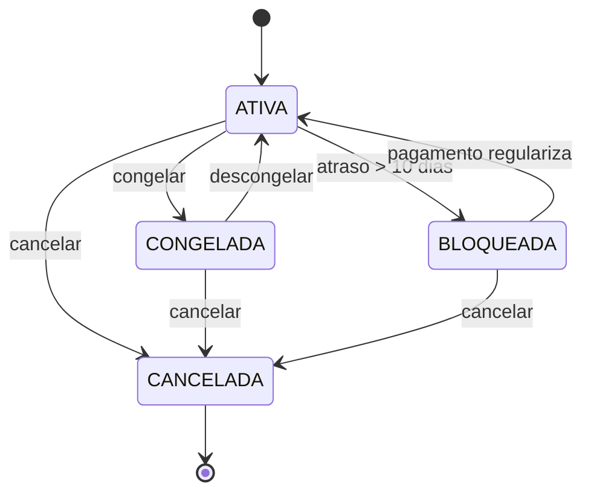

# HealthTech — Academia e Planos (D2)

Sistema de console em **Java** para gerenciar uma academia: matrículas, planos, mensalidades, check-ins, congelamento, mudança de plano, avaliação física e aulas coletivas com lista de espera. O projeto foi feito para praticar **Programação Orientada a Objetos** (herança, polimorfismo, interfaces, encapsulamento e objetos de valor), com as regras de negócio concentradas no domínio.

## Funcionalidades

- Matrícula de alunos (um aluno, uma matrícula, um plano)
- Planos Mensal, Trimestral e Anual, cada um com preço e regras próprias
- Check-in diário, permitido somente com a matrícula ativa
- Geração e pagamento de mensalidades, com bloqueio automático por atraso
- Congelamento (somente plano Anual, até 30 dias por ano) e descongelamento
- Cancelamento definitivo de matrícula
- Mudança de plano agendada para o próximo mês
- Avaliação física com validade de 90 dias, que define a ficha de treino
- Aulas coletivas com capacidade máxima e lista de espera por ordem de inscrição
- Relógio simulado para testar atrasos e vencimentos sem esperar o tempo passar

## Tecnologias

- Java 17 ou superior (usa `record`, `switch` com setas e text blocks)
- Apenas a biblioteca padrão, sem dependências externas
- Interface de linha de comando (menu no terminal)

## Estrutura do projeto

```text
src/academia/
├── app/         # Main: menu de console (só orquestra, sem regras)
├── enums/       # EstadoMatricula, TipoPlano, ObjetivoTreino, ResultadoInscricao
├── excecoes/    # RegraDeNegocioException e suas especializações
├── interfaces/  # RelogioAcademia, Vencivel
├── modelo/      # Aluno, Matricula, Mensalidade, AvaliacaoFisica, AulaColetiva
├── plano/       # Plano (abstrata), PlanoMensal, PlanoTrimestral, PlanoAnual
├── servico/     # SecretariaDaAcademia (casos de uso), RelogioSimulado
└── valor/       # Cpf, Dinheiro, FichaTreino (objetos de valor imutáveis)
```

Documentação na raiz:

| Arquivo | Conteúdo |
|---|---|
| `Regras De Negócio - POO.docx` | Regras RN01 a RN08 |
| `DIAGRAMA-DE-CLASSES - POO.md` | Diagrama de classes e hierarquia de exceções (Mermaid) |
| `glossario-1.pdf` | Glossário da linguagem ubíqua |
| `ADR-0001.md` | Plano como classe abstrata |
| `ADR-0002.md` | Transições de estado da matrícula no enum `EstadoMatricula` |

## Como executar

Pré-requisito: JDK 17 ou superior.

Na raiz do projeto, compile e execute:

```bash
mkdir out
javac -d out $(find src -name "*.java")
java -cp out academia.app.Main
```

No Windows (PowerShell):

```powershell
mkdir out
javac -d out (Get-ChildItem -Recurse src -Filter *.java).FullName
java -cp out academia.app.Main
```

Também é possível abrir a pasta em uma IDE (como o IntelliJ IDEA) e executar a classe `academia.app.Main`.

## Dados de exemplo

Ao iniciar, o sistema carrega quatro alunos e duas aulas:

| Aluno | CPF | Plano | Situação inicial |
|---|---|---|---|
| Ana Souza | 52998224725 | Anual | Mensalidade pendente |
| Bruno Lima | 11144477735 | Mensal | Mensalidade pendente |
| Carla Mendes | 39053344705 | Trimestral | Em dia; avaliação vence em 5 dias |
| Diego Ramos | 16899535009 | Mensal | Em dia |

Aulas: **Spinning** (2 vagas, já lotada com Ana e Diego) e **Yoga** (3 vagas).

## Menu

```text
 1 - Matricular aluno         9 - Mudar de plano (upgrade)
 2 - Listar matrículas       10 - Renovar avaliação física
 3 - Check-in                11 - Ficha de treino e vencimentos
 4 - Gerar mensalidade       12 - Listar aulas coletivas
 5 - Pagar mensalidade       13 - Inscrever em aula
 6 - Congelar                14 - Cancelar inscrição em aula
 7 - Descongelar             15 - Avançar data simulada
 8 - Cancelar matrícula       0 - Sair
```

Dica: use a opção **15** para avançar o relógio e ver o bloqueio por atraso (mais de 10 dias) ou o congelamento por avaliação física vencida (mais de 90 dias).

## Planos

| Plano | Preço mensal | Contrato | Congelamento |
|---|---|---|---|
| Mensal | R$ 99,90 | 1 mês | Não |
| Trimestral | R$ 89,90 | 3 meses | Não |
| Anual | R$ 79,90 | 12 meses | Até 30 dias por ano |

## Regras de negócio

| Código | Regra | Onde está no código |
|---|---|---|
| RN01 | Um aluno tem uma matrícula; cada matrícula tem um único plano | `Matricula.abrir()`, `Aluno.vincular()` |
| RN02 | Cada plano tem preço e regras próprias; só o Anual congela (30 dias/ano) | `Plano` e subclasses, `Matricula.congelar()` |
| RN03 | Check-in só com matrícula ativa, no máximo 1 por dia | `Matricula.fazerCheckin()` |
| RN04 | Mensalidade com mais de 10 dias de atraso bloqueia a matrícula; o pagamento reativa | `Matricula.atualizarSituacao()`, `pagarMensalidade()` |
| RN05 | Aula com capacidade máxima e lista de espera por ordem de inscrição | `AulaColetiva` |
| RN06 | Ciclo de vida: ativa, congelada, bloqueada e cancelada (estado final) | `EstadoMatricula` |
| RN07 | Mudança de plano exige matrícula ativa e sem pendências, e vale no mês seguinte | `Matricula.solicitarMudancaDePlano()` |
| RN08 | Avaliação física obrigatória, válida por 90 dias, define a ficha de treino | `AvaliacaoFisica`, `Matricula.atualizarSituacao()` |

### Ciclo de vida da matrícula



## Decisões de projeto

- **Plano abstrato:** a elegibilidade e o limite de congelamento ficam em cada plano, sem `if` por tipo (ver ADR-0001).
- **Estado encapsulado em enum:** as transições válidas ficam em `EstadoMatricula` e as demais lançam exceção (ver ADR-0002).
- **Interfaces:** `RelogioAcademia` é injetada na `SecretariaDaAcademia`, o que permite o `RelogioSimulado`. `Vencivel` é implementada por `Mensalidade` e `AvaliacaoFisica`, que não têm herança em comum.
- **Objetos de valor imutáveis:** `Cpf`, `Dinheiro` e `FichaTreino` são `record`s que validam os dados na construção.
- **Encapsulamento:** `Matricula` não tem setters públicos e só nasce por `Matricula.abrir()`; as listas são devolvidas como cópias imutáveis.
- **Exceções de domínio:** todas herdam de `RegraDeNegocioException`; o `Main` as captura e mostra a mensagem sem encerrar o programa.
- **Ordenação:** `Aluno` é `Comparable` e `Matricula` expõe comparadores (`POR_NOME`, `POR_ESTADO_E_NOME`).

## Limitações

- Os dados ficam apenas em memória e são perdidos ao fechar o programa.
- Não há testes automatizados nem ferramenta de build (Maven ou Gradle).
- Este repositório não define uma licença.
